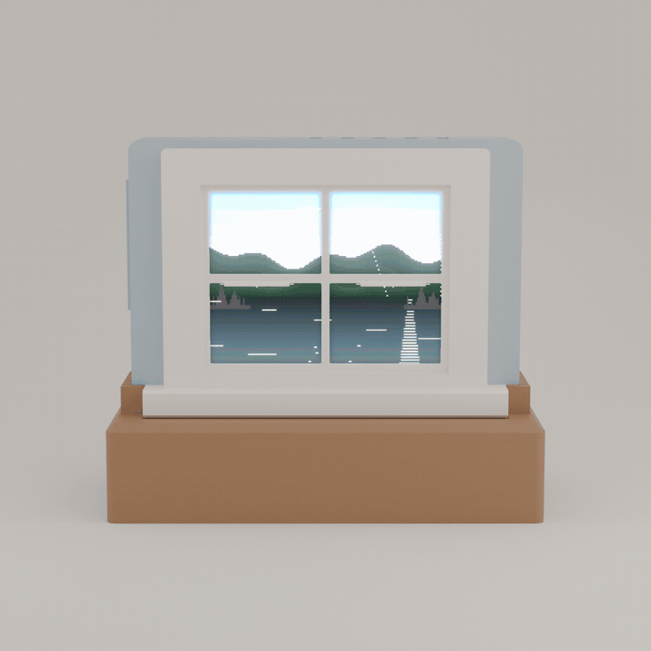

# CYD 小さな窓 / tiny-window

ESP32 Cheap Yellow Display（**ESP32-2432S028**）向けの、卓上「小さな窓」ファームウェアです。家のない幻想的な湖景が、時間帯と天気で移ろいます。

A desktop “tiny window” firmware for the ESP32 Cheap Yellow Display (**ESP32-2432S028**). A house-less, slightly fantastical lake view changes with time of day and weather.



- ファームウェア版 / Firmware: **tiny-window 0.1.4**
- ケース（3Dプリント） / Case: MakerWorld に公開予定（URL は後で追記します / **TODO: add MakerWorld URL**）
- ライセンス / License: [CC BY-NC-SA 4.0](LICENSE)（第三者が提供するライブラリは各ライセンス。詳しくは [THIRD_PARTY.md](THIRD_PARTY.md)）

---

## 日本語

### 概要

画面にはソフトの窓枠を描かず、3Dプリントした物理の窓枠と十字桟で見せる想定です。時間帯は NTP（日本標準時）から、天気の種類は [Open-Meteo](https://open-meteo.com/) から取得します（API キー不要、約 10 分ごと）。Wi-Fi の SSID とパスワードはソースにも書き込み用バイナリにも含まれません。

### 対応基板

- **ESP32-2432S028**（いわゆる CYD / Cheap Yellow Display）
- 作者の個体は 2 ポート（microUSB + USB-C）、LCD は **ILI9341**、書き込み用の既定プロファイルは `cyd_ili9341`
- 同じ型番でも LCD コントローラや色順に版差があります。色がおかしいときは `firmware/platformio.ini` の他プロファイル（`cyd_ili9341_inv` / `cyd_ili9342` / `cyd_st7789_*`）を試してください

### 機能

- 時間帯（朝・昼・夕・夜）は NTP（`JST-9`、`ntp.nict.jp` と `pool.ntp.org`）の現地時刻で更新
- 天気（晴れ・曇り・雨）は Open-Meteo。未設定時の位置は東京（35.68, 139.76）
- 初回設定は WiFiManager。ボードが設定用アクセスポイント **`TinyWindow-Setup`**（パスワードなし）を出すので、http://192.168.4.1 で家庭の Wi-Fi を入れる
- 接続や取得に失敗しても湖景は止めず、前回の天気種別を維持する。時間帯は時計が取れ次第進む
- シリアル（115200 8N1）コマンド例:
  - `status` — 状態
  - `wifi` — 接続状態と最後の天気
  - `wifi reset` — 保存した SSID を消して再起動し、設定用 AP を出す
  - `wifi ap` — 設定用 AP だけ出す
  - `fetch` — 天気を再取得してライブ更新を再開
  - ほか `help`、`weather clear|cloud|rain`、`phase morning|day|evening|night|auto`、`lat` / `lon` など

### ビルド

[PlatformIO](https://platformio.org/) 6.1.18 と esptool 5.6.0 で確認しています。

```bash
cd firmware
pip install -r requirements-host.txt
pio run -e cyd_ili9341
```

成果物は `firmware/.pio/build/cyd_ili9341/` に出ます。ピン留めしている主な依存は `espressif32@6.8.1`（Arduino-ESP32 2.0.17）、`bodmer/TFT_eSPI@2.5.43`、`tzapu/WiFiManager@2.0.17` です。

### 書き込み（esptool）

事前ビルド済みのバイナリは [Releases の v0.1.4](https://github.com/naotochan/cyd-tiny-window/releases/tag/v0.1.4) と、リポジトリ内の `firmware-bin/cyd_ili9341/` にあります。

- `firmware.bin`（app のみ、アドレス **0x10000**）— 更新時の推奨。NVS に保存した Wi-Fi 設定を残します
  - SHA256: `af32dd660ebc8e9604ed3c0167631d7849539d0c5b8abc7928172d444bca7086`
- 新品の CYD や、パーティションを変えたときだけ、bootloader / partitions / boot_app0 も含めたフル書き込みを使います（NVS は消えることがあります）

シリアルポートは環境ごとに違います。Mac なら `/dev/cu.usbserial-XXXX`、Windows なら `COMx` を指定してください。

**すでにこのファームが入っていて、Wi-Fi 設定を残したいとき（app のみ）:**

```bash
esptool --chip esp32 --port /dev/cu.usbserial-XXXX --baud 460800 \
  --before default-reset --after hard-reset \
  write-flash --flash-mode dio --flash-freq 40m --flash-size 4MB \
  0x10000 firmware.bin
```

**新品の CYD への初回、またはパーティション変更時（フル書き込み）:**

```bash
esptool --chip esp32 --port /dev/cu.usbserial-XXXX --baud 460800 \
  --before default-reset --after hard-reset \
  write-flash --flash-mode dio --flash-freq 40m --flash-size 4MB \
  0x1000 bootloader.bin \
  0x8000 partitions.bin \
  0xe000 boot_app0.bin \
  0x10000 firmware.bin
```

`merged.bin` を使う場合は先頭アドレス `0x0` です（フル書き込みと同じく NVS が消えることがあります）。

```bash
esptool --chip esp32 --port /dev/cu.usbserial-XXXX --baud 460800 \
  --before default-reset --after hard-reset \
  write-flash --flash-mode dio --flash-freq 40m --flash-size 4MB \
  0x0 merged.bin
```

Windows では `--port COM3` のように書き換えてください。失敗したらボーレートを `115200` に落とします。必要なら BOOT を押しながらリセットしてください。

書き込み後のシリアルモニタ例:

```bash
# macOS / Linux
ls /dev/cu.usbserial-* /dev/cu.wchusbserial* /dev/ttyUSB* 2>/dev/null
screen /dev/cu.usbserial-XXXX 115200
```

起動バナーに `tiny-window 0.1.4` が出ます。

### ケース

3Dプリント筐体は MakerWorld で公開する予定です。URL は後でこの README に追記します（**TODO**）。

### 配線・電源の注意

- **USB で電源を取っているあいだは、電源スイッチを OFF にする。** ケースのスイッチは PowerBoost の EN です。ON のまま USB を繋ぐと、電池側の 5V と USB の 5V がぶつかります（書き込みのときも OFF）
- CYD の **P1 は VIN と GND のみ**使う。ピンは VIN / TX / RX / GND の順です。TX と RX をショートさせない（書き込み不能になります）

### ライセンス

このリポジトリのオリジナルのソース・文書・画像は [CC BY-NC-SA 4.0](LICENSE) です。TFT_eSPI、WiFiManager、Arduino-ESP32 など、ビルドや書き込み用バイナリに含まれる第三者のコードは、それぞれのライセンスのままです。詳しくは [THIRD_PARTY.md](THIRD_PARTY.md)。

---

## English

### Overview

The firmware draws a house-less lake view and does not draw an on-screen window frame; a 3D-printed frame and mullions are meant to do that. Time of day comes from NTP (Japan Standard Time). Weather type comes from [Open-Meteo](https://open-meteo.com/) (no API key, about every 10 minutes). Wi-Fi SSID and password are not stored in the source or in the flash images in this repository.

### Supported board

- **ESP32-2432S028** (CYD / Cheap Yellow Display)
- The author’s unit is the dual-USB (microUSB + USB-C) variant with an **ILI9341** panel. The default flash profile is `cyd_ili9341`
- LCD controller and colour order can differ between batches of the same part number. If colours look wrong, try the other environments in `firmware/platformio.ini` (`cyd_ili9341_inv`, `cyd_ili9342`, `cyd_st7789_*`)

### Features

- Time of day (morning, day, evening, night) is updated from NTP (`JST-9`, `ntp.nict.jp` and `pool.ntp.org`)
- Weather (clear, cloudy, rain) comes from Open-Meteo. The default map coordinates are Tokyo (35.68, 139.76)
- First-time setup uses WiFiManager. The board raises a **`TinyWindow-Setup`** access point (no password); open http://192.168.4.1 and enter your home Wi-Fi
- If the network or weather fetch fails, the scene keeps running with the last weather type. Time of day advances once the clock is available
- Serial port (115200 8N1) commands include:
  - `status` — status
  - `wifi` — connection state and last weather
  - `wifi reset` — erase the saved SSID, reboot, and raise the setup AP
  - `wifi ap` — raise the setup AP only
  - `fetch` — fetch weather again and resume live updates
  - also `help`, `weather clear|cloud|rain`, `phase morning|day|evening|night|auto`, `lat` / `lon`, and others

### Build

Verified with [PlatformIO](https://platformio.org/) 6.1.18 and esptool 5.6.0.

```bash
cd firmware
pip install -r requirements-host.txt
pio run -e cyd_ili9341
```

Build output is under `firmware/.pio/build/cyd_ili9341/`. Pinned dependencies include `espressif32@6.8.1` (Arduino-ESP32 2.0.17), `bodmer/TFT_eSPI@2.5.43`, and `tzapu/WiFiManager@2.0.17`.

### Flashing (esptool)

Prebuilt images are in [the v0.1.4 release](https://github.com/naotochan/cyd-tiny-window/releases/tag/v0.1.4) and in `firmware-bin/cyd_ili9341/` in this repository.

- `firmware.bin` (app only, address **0x10000**) — preferred for updates, so Wi-Fi settings in NVS are kept
  - SHA256: `af32dd660ebc8e9604ed3c0167631d7849539d0c5b8abc7928172d444bca7086`
- For a brand-new CYD, or after a partition change, use a full flash that also writes the bootloader, partition table, and boot_app0 (this may erase NVS)

The serial port name depends on your OS. On macOS it is typically `/dev/cu.usbserial-XXXX`; on Windows it is `COMx`.

**Update that keeps Wi-Fi settings (app only):**

```bash
esptool --chip esp32 --port /dev/cu.usbserial-XXXX --baud 460800 \
  --before default-reset --after hard-reset \
  write-flash --flash-mode dio --flash-freq 40m --flash-size 4MB \
  0x10000 firmware.bin
```

**First flash on a new CYD, or after partition changes (full flash):**

```bash
esptool --chip esp32 --port /dev/cu.usbserial-XXXX --baud 460800 \
  --before default-reset --after hard-reset \
  write-flash --flash-mode dio --flash-freq 40m --flash-size 4MB \
  0x1000 bootloader.bin \
  0x8000 partitions.bin \
  0xe000 boot_app0.bin \
  0x10000 firmware.bin
```

To use `merged.bin`, write it at offset `0x0` (this may also wipe NVS):

```bash
esptool --chip esp32 --port /dev/cu.usbserial-XXXX --baud 460800 \
  --before default-reset --after hard-reset \
  write-flash --flash-mode dio --flash-freq 40m --flash-size 4MB \
  0x0 merged.bin
```

On Windows, replace the port with `--port COM3` (or whichever port you have). If the write fails, drop the baud rate to `115200`. Holding BOOT while resetting can help on some CH340 boards.

Example serial monitor:

```bash
# macOS / Linux
ls /dev/cu.usbserial-* /dev/cu.wchusbserial* /dev/ttyUSB* 2>/dev/null
screen /dev/cu.usbserial-XXXX 115200
```

The boot banner should show `tiny-window 0.1.4`.

### Case

The 3D-printed enclosure will be published on MakerWorld. The URL will be added to this README later (**TODO**).

### Wiring and power

- **Keep the power switch OFF while USB is connected.** In the case, the switch is the PowerBoost EN pin. Leaving it ON feeds battery 5 V and USB 5 V into each other. The same rule applies when flashing
- On the CYD **P1 connector, use VIN and GND only**. The pin order is VIN, TX, RX, GND. Do not short TX to RX — that blocks flashing

### License

Original source, documentation, and media in this repository are [CC BY-NC-SA 4.0](LICENSE). Third-party code used at build time or linked into the prebuilt firmware images (TFT_eSPI, WiFiManager, Arduino-ESP32, and others) remains under its own licenses. See [THIRD_PARTY.md](THIRD_PARTY.md).
